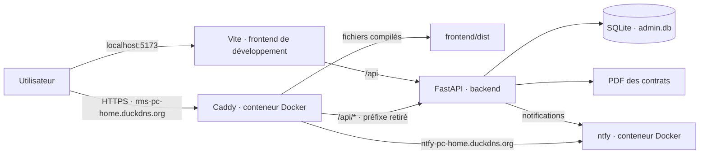

# RMS — Architecture de la plateforme

## Vue d’ensemble

## Où se trouvent les éléments

| Chemin | Contenu |
|---|---|
| `/opt/ntfy-admin/frontend` | Interface RMS React/Vite, sources et version compilée `dist` |
| `/opt/ntfy-admin/backend` | API FastAPI, environnement Python et données RMS |
| `/opt/ntfy-admin/backend/app/main.py` | Routes et logique API : authentification, profils, missions, notifications, contrats |
| `/opt/ntfy-admin/backend/app/db.py` | Connexion et initialisation de la base SQLite |
| `/opt/ntfy-admin/backend/data/admin.db` | Base SQLite RMS : comptes, profils, missions, disponibilités, événements et contrats |
| `/opt/ntfy-admin/backend/data/contracts` | PDF privés des brouillons de contrat |
| `/opt/ntfy-admin/frontend/dist` | Interface compilée que Caddy sert sur l’adresse publique RMS |
| `/opt/ntfy` | Docker Compose, configuration Caddy et données/configuration du serveur ntfy |
| `/etc/systemd/system/ntfy-admin-*.service` | Démarrage automatique de l’API et du frontend local |

## Chemin d’une requête

- **En local** : le navigateur ouvre Vite sur `localhost:5173`. Vite transmet `/api/...` à FastAPI sur `172.18.0.1:8000`.
- **Depuis Internet** : Caddy fournit HTTPS et sert les fichiers de `frontend/dist`. Les chemins `/api/...` sont transmis au même backend, en retirant le préfixe `/api`.
- **Notification** : l’API RMS utilise le serveur ntfy existant pour transmettre les notifications aux canaux associés aux profils sélectionnés.
- **E-mail de contrat** : l’API utilise les paramètres SMTP du fichier `.env` du backend. Les secrets restent dans ce fichier et ne doivent pas être copiés dans les documents.

## Modules fonctionnels présents

- **Accueil et missions** : indicateurs, missions récentes, création et suivi.
- **Correspondance de profils** : recherche de profils compatibles en consultation, sélection manuelle et notification ntfy.
- **Profils intérimaires** : création, recherche, filtres, modification, canaux ntfy et périodes de disponibilité.
- **Contrats & signature** : brouillon PDF, deux signataires, invitations e-mail et suivi des réponses.
- **Modules/formules** : écran de présentation/configuration des options de la maquette.
- **Administration et activité** : comptes, droits et journalisation selon les écrans et routes activés.

## Données et accès

La base RMS est locale et SQLite. Les données de ntfy sont séparées dans `/opt/ntfy`. Le backend fonctionne sous le compte système `rachid_1965`; il doit pouvoir écrire dans `backend/data` et `backend/data/contracts`. Si l’enregistrement PDF échoue avec `Permission denied`, vérifiez la propriété de ce dernier dossier.

Le prototype de signature conserve un nom, un consentement et un horodatage. Il ne fournit pas une signature électronique qualifiée ni une validation juridique automatique du contrat.
